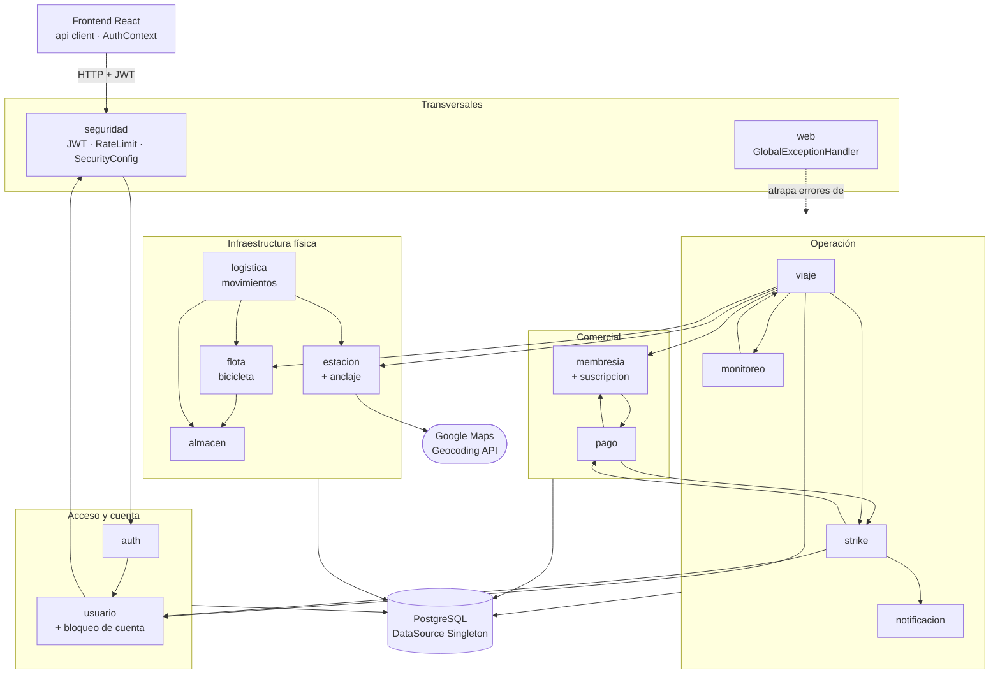

# PeopleBikes — Componentes del sistema

Trabajo práctico de **Programación Orientada a Componentes**.

El backend es Spring Boot 3 + JPA + PostgreSQL. El frontend es React + TypeScript. Cada
componente del backend vive en `src/main/java/com/mediconecta/modulos/<componente>/` y
tiene siempre las mismas cinco capas:

| Capa | Qué hace |
|---|---|
| `controller` | Recibe el HTTP, valida el rol con `@PreAuthorize`. No tiene lógica de negocio. |
| `service` | La lógica de negocio y las transacciones (`@Transactional`). |
| `repository` | Acceso a la base (Spring Data JPA). |
| `entity` | La tabla y sus reglas (sin setters: solo métodos con nombre de acción). |
| `dto` | Lo que entra y sale por HTTP. La entity nunca se expone directo. |

---

## Índice

1. [Diagrama general](#1-diagrama-general)
2. [Patrones de diseño que se repiten en todos los componentes](#2-patrones-de-diseño-transversales)
3. Componentes de dominio
   - [auth](#31-auth--autenticación) · [usuario](#32-usuario--usuarios-y-bloqueo-de-cuenta) · [membresia](#33-membresia--planes-y-suscripciones) · [pago](#34-pago)
   - [estacion](#35-estacion--estaciones-anclajes-y-geocoding) · [flota](#36-flota--bicicletas) · [almacen](#37-almacen) · [logistica](#38-logistica--traslado-de-bicis)
   - [viaje](#39-viaje) · [strike](#310-strike--penalizaciones) · [notificacion](#311-notificacion) · [monitoreo](#312-monitoreo--usuarios-activos) · [saludo](#313-saludo--componente-de-prueba)
4. [Componentes de infraestructura](#4-componentes-de-infraestructura): seguridad, web, base de datos, frontend
5. [Resumen de patrones](#5-resumen-de-patrones-por-componente)

---

## 1. Diagrama general

Flecha llena = un componente **usa** a otro. Todos persisten en la base de datos (se
dibuja una sola vez para no ensuciar el diagrama).

> Hay flechas de ida y vuelta entre módulos (por ejemplo `pago ↔ strike`), pero **no hay
> ciclos entre services**: uno llama al *service* del otro y el otro solo lee su
> *repository*. Así Spring puede construir todos los beans sin dependencias circulares.

---

## 2. Patrones de diseño transversales

Estos patrones aparecen en **todos** los componentes; en cada sección de abajo se indican
solo los patrones propios de ese componente.

### Singleton — base de datos y todos los beans

Spring crea **una única instancia** de cada `@Service`, `@Repository`, `@Component` y
`@Configuration` (scope `singleton`, el default) y la comparte en toda la aplicación.

- **Base de datos:** el `DataSource` (pool de conexiones HikariCP) y el
  `EntityManagerFactory` se crean una sola vez al arrancar, a partir de
  `spring.datasource.*` en `application.properties`. Todos los repositorios usan esa
  misma instancia.
- **Por qué:** abrir una conexión a PostgreSQL es caro. Con un único pool compartido las
  conexiones se reutilizan y se controla cuántas hay abiertas. Si cada service creara su
  propio acceso, se agotarían las conexiones de la base.
- Otro ejemplo donde el Singleton es **necesario**: `UsuariosActivosService` guarda el
  contador de usuarios en viaje en un `AtomicInteger` en memoria. Funciona porque existe
  una sola instancia; con dos, cada una tendría un número distinto.
- La diferencia con el Singleton clásico (constructor privado + `getInstance()`) es que
  acá lo gestiona el contenedor, lo que permite reemplazarlo por un mock en los tests.

### Inyección de Dependencias / Inversión de Control

Todos los services y controllers reciben sus dependencias **por constructor**
(sin `@Autowired` en campos). Spring es quien las crea y las conecta.
**Por qué:** los componentes no se instancian entre sí (`new`), dependen de lo que les
pasan. Eso bajo acoplamiento es la base de la programación orientada a componentes, y
permite testear cada uno por separado.

### Repository

Cada `XxxRepository extends JpaRepository<Entidad, Long>`. **Por qué:** separa la lógica
de negocio de cómo se guarda. El service pide `findByUsuarioIdAndFechaFinIsNull(id)` sin
escribir SQL; si mañana cambia la base, el service no se entera.

### Proxy (dinámico)

- Spring **genera en tiempo de ejecución** la implementación de cada interfaz `Repository`.
- `@Transactional` y `@PreAuthorize` funcionan envolviendo el bean en un proxy que abre/cierra
  la transacción o verifica el rol **antes** de llegar al método real.

**Por qué:** agrega transacciones y seguridad sin mezclar ese código dentro de la lógica
de negocio.

### DTO + Static Factory Method

Los DTO son `record` inmutables. Los de salida tienen un método estático
`XxxResponse.desde(entidad)`; los de entrada validan con `@NotBlank`, `@Size`, `@Positive`…
**Por qué:** la entity nunca sale por HTTP (no se filtra, por ejemplo, el `passwordHash`),
y la conversión está en un solo lugar en vez de repetida en cada service.

### Modelo de dominio rico (encapsulamiento)

Las entities no tienen setters. Tienen un constructor con los datos obligatorios y métodos
de negocio: `viaje.finalizar(anclaje)`, `bicicleta.anclarEn(anclaje)`, `strike.saldar()`.
**Por qué:** ningún componente puede dejar una entidad en un estado inválido
(ej. una bici con anclaje y almacén a la vez).

### Máquina de estados con enums

Los estados son enums guardados como texto (`@Enumerated(EnumType.STRING)`) y las
transiciones solo las hace la entity. **Por qué:** agregar un valor nuevo al enum no
corrompe los datos ya guardados (con `ORDINAL` sí pasaría).

---

## 3. Componentes de dominio

### 3.1 auth — Autenticación

Login, registro y renovación de tokens. **No tiene entity propia**: usa `Usuario`.

**Patrones**
- **Facade:** `AuthService.login()` esconde detrás de una sola llamada el
  `AuthenticationManager`, la búsqueda del usuario y la generación de dos tokens JWT.
- **Factory Method:** `AuthResponse.de(...)` arma la respuesta fijando `tokenType = "Bearer"`.

**DTOs**
| DTO | Atributos |
|---|---|
| `LoginRequest` | `email`, `password` |
| `RegisterRequest` | `nombre`, `apellido`, `email`, `password` (8–72), `dni`, `telefono` |
| `RefreshRequest` | `refreshToken` |
| `AuthResponse` | `accessToken`, `refreshToken`, `tokenType`, `expiraEnSegundos`, `usuario` (UsuarioResponse) |

**Funciones** — `AuthService`: `login()`, `refresh()`
**Endpoints** — `POST /api/auth/login`, `/register`, `/refresh`, `GET /api/auth/me`

**Se conecta con:** `usuario` (crea el cliente y lo busca), `seguridad` (`JwtTokenProvider`).

---

### 3.2 usuario — Usuarios y bloqueo de cuenta

ABM de usuarios (ADMIN y CLIENTE) y el historial de bloqueos por strikes.

**Patrones**
- **Baja lógica:** `desactivar()` en vez de borrar, para no romper viajes y pagos históricos.
- **Historial como entidad separada:** el bloqueo es `BloqueoCuenta` (quién, cuándo,
  por qué, qué admin lo levantó) y no un `boolean bloqueado` en `Usuario`.
- **Strategy:** la contraseña se hashea con la interfaz `PasswordEncoder`; la estrategia
  concreta (`BCryptPasswordEncoder`) se elige en `SecurityConfig` y se puede cambiar sin
  tocar `UsuarioService`.

**Entity `Usuario`**: `id`, `nombre`, `apellido`, `email` (único), `passwordHash`,
`dni` (único), `telefono`, `rol` (`ADMIN` / `CLIENTE`), `activo`, `fechaCreacion`.
Métodos: `actualizarDatos()`, `desactivar()`.

**Entity `BloqueoCuenta`**: `id`, `usuario`, `fechaBloqueo`, `motivo`, `activo`,
`fechaDesbloqueo`, `adminDesbloqueo`. Método: `desbloquear(admin)`.

**DTOs**
| DTO | Atributos |
|---|---|
| `UsuarioRequest` | `nombre`, `apellido`, `email`, `password`, `dni`, `telefono`, `rol` |
| `UsuarioUpdateRequest` | `nombre`, `apellido`, `dni`, `telefono`, `rol` |
| `UsuarioResponse` | `id`, `nombre`, `apellido`, `email`, `dni`, `telefono`, `rol`, `activo`, `fechaCreacion` (nunca la password) |
| `BloqueoCuentaResponse` | `id`, `usuarioId`, `fechaBloqueo`, `motivo`, `activo`, `fechaDesbloqueo` |

**Funciones**
- `UsuarioService`: `crear()`, `registrarCliente()`, `listar()`, `obtenerPorId()`, `actualizar()`, `desactivar()`
- `BloqueoCuentaService`: `estaBloqueado()`, `obtenerActivo()`, `desbloquear()`

**Se conecta con:** `auth` (registro), `seguridad` (`PasswordEncoder`, `UserPrincipal`),
`strike` (crea el bloqueo), `viaje` (consulta si está bloqueado), `logistica` y `pago`
(buscan al usuario).

---

### 3.3 membresia — Planes y suscripciones

Catálogo de planes (`Membresia`) y la contratación de un plan por un usuario (`SuscripcionUsuario`).

**Patrones**
- **Enum con comportamiento:** `TipoMembresia` (`INDIVIDUAL(1)`, `SEMANAL(7)`, `MENSUAL(30)`)
  sabe cuántos días dura. **Por qué:** la regla está en un solo lugar, sin `switch`
  repartidos por el código.
- **Baja lógica:** `Membresia.desactivar()`, `SuscripcionUsuario.cancelar()`.
- **Ownership check en el service:** solo el dueño puede cancelar su suscripción (403 si no).

**Entity `Membresia`**: `id`, `nombre`, `tipo`, `tiempoPermitidoMinutos`, `precio`,
`tarifaMinutoExtra`, `viajesPorDia`, `tiempoEsperaMinutos`, `activa`.

**Entity `SuscripcionUsuario`**: `id`, `usuario`, `membresia`, `fechaInicio`, `fechaFin`,
`estado` (`ACTIVA` / `VENCIDA` / `CANCELADA`). Métodos: `cancelar()`, `vencer()`.

**DTOs**
| DTO | Atributos |
|---|---|
| `MembresiaRequest` | `nombre`, `tipo`, `tiempoPermitidoMinutos`, `precio`, `tarifaMinutoExtra`, `viajesPorDia`, `tiempoEsperaMinutos` |
| `MembresiaResponse` | lo anterior + `id`, `duracionDias`, `activa` |
| `SuscripcionRequest` | `membresiaId` |
| `SuscripcionResponse` | `id`, `usuarioId`, `membresiaId`, `fechaInicio`, `fechaFin`, `estado` |

**Funciones**
- `MembresiaService`: `crear()`, `listar()`, `obtenerPorId()`, `desactivar()`
- `SuscripcionUsuarioService`: `contratar()` (genera un pago pendiente), `listarPropias()`, `cancelar()`

**Se conecta con:** `pago` (contratar crea un `Pago`; al confirmarse, `pago` crea la
suscripción), `usuario`, `viaje` (exige plan vigente).

---

### 3.4 pago

Cobros de membresías y de tiempo extra. La confirmación simula una pasarela externa.

**Patrones**
- **Punto único de creación (Factory):** `PagoService.crear()` es el **único** lugar donde
  nace un `Pago`. Lo usan `membresia` y `strike`. **Por qué:** el estado inicial
  (`PENDIENTE`, fecha de creación) queda centralizado.
- **Máquina de estados idempotente:** `Pago.confirmar()` devuelve `false` si ya estaba
  pagado. **Por qué:** las pasarelas (Mercado Pago) reenvían la confirmación; sin esto,
  un reintento crearía dos suscripciones.
- **Ownership check:** solo el dueño o un ADMIN pueden ver/confirmar/rechazar.

**Entity `Pago`**: `id`, `usuario`, `viaje` (nullable), `membresia` (nullable),
`concepto` (`TIEMPO_EXTRA` / `MEMBRESIA`), `monto`, `estado` (`PENDIENTE` / `PAGADO` /
`RECHAZADO`), `fechaCreacion`, `fechaResolucion`, `referenciaPasarela`.
Métodos: `confirmar()`, `rechazar()`.

**DTOs**
| DTO | Atributos |
|---|---|
| `PagoConfirmarRequest` | `referenciaPasarela` |
| `PagoResponse` | `id`, `usuarioId`, `viajeId`, `membresiaId`, `concepto`, `monto`, `estado`, `fechaCreacion`, `fechaResolucion`, `referenciaPasarela` |

**Funciones** — `PagoService`: `crear()`, `listarPropios()`, `obtener()`, `confirmar()`, `rechazar()`

**Se conecta con:** `membresia` (al confirmar un pago de plan, crea la suscripción),
`strike` (al confirmar tiempo extra, salda el strike), `usuario`, `viaje`.

---

### 3.5 estacion — Estaciones, anclajes y geocoding

Estaciones de bicis, sus anclajes (docks) y la conversión dirección → coordenadas.

**Patrones**
- **Adapter / Gateway:** `GeocodingService` traduce la respuesta JSON de Google Maps a un
  objeto propio `Coordenadas(latitud, longitud)`. **Por qué:** el resto del sistema no
  conoce la API de Google; si se cambia de proveedor, solo cambia esta clase.
- **Degradación elegante:** si no hay API key o Google falla, devuelve `Optional.empty()`
  y la estación se guarda igual, sin coordenadas.
- **Builder** (de librería): `RestClient.builder()` para armar el cliente HTTP con timeouts.

**Entity `Estacion`**: `id`, `nombre`, `direccion`, `latitud`, `longitud`, `capacidad`, `activa`.
Métodos: `desactivar()`, `actualizarDatos()`, `asignarCoordenadas()`, `limpiarCoordenadas()`.

**Entity `Anclaje`**: `id`, `estacion`, `numero` (único por estación), `estado`
(`LIBRE` / `OCUPADO` / `FUERA_SERVICIO`). Métodos: `ocupar()`, `liberar()`, `marcarFueraServicio()`.

**DTOs**
| DTO | Atributos |
|---|---|
| `EstacionRequest` | `nombre`, `direccion`, `latitud`, `longitud`, `capacidad` |
| `EstacionUpdateRequest` | `nombre`, `direccion`, `capacidad` (sin coordenadas: se recalculan) |
| `EstacionResponse` | `id`, `nombre`, `direccion`, `latitud`, `longitud`, `capacidad`, `activa` |
| `AnclajeRequest` | `numero` |
| `AnclajeResponse` | `id`, `estacionId`, `numero`, `estado` |

**Funciones**
- `EstacionService`: `crear()`, `actualizar()`, `geocodificar()`, `listar()`, `obtenerPorId()`, `desactivar()`
- `AnclajeService`: `agregar()`, `listarPorEstacion()`, `marcarFueraServicio()`, `habilitar()`
- `GeocodingService`: `geocodificar(direccion)`

**Se conecta con:** Google Maps (externo), `viaje` y `logistica` (ocupan/liberan anclajes),
`flota` (la bici está en un anclaje).

---

### 3.6 flota — Bicicletas

**Patrones**
- **Ubicación polimórfica con dos FK nullable:** la bici está en un `anclaje` **o** en un
  `almacen`, nunca en ambos. **Por qué:** más simple que herencia JPA para este tamaño; la
  regla "exactamente uno" la garantizan los métodos de la entity (`anclarEn()` pone
  `almacen = null`, y viceversa).
- **Máquina de estados:** `DISPONIBLE`, `EN_VIAJE`, `DESACTIVADA`, `EN_REPARACION`.

**Entity `Bicicleta`**: `id`, `codigo` (único, el que se escanea), `estado`, `anclaje`, `almacen`.
Métodos: `retirarDeAnclaje()`, `anclarEn()`, `moverAAlmacen()`.

**DTOs**
| DTO | Atributos |
|---|---|
| `BicicletaRequest` | `codigo`, `almacenId` |
| `BicicletaEstadoRequest` | `estado` |
| `BicicletaResponse` | `id`, `codigo`, `estado`, `anclajeId`, `almacenId` |

**Funciones** — `BicicletaService`: `crear()`, `listar()`, `obtenerPorId()`, `cambiarEstadoEnAlmacen()`

**Se conecta con:** `almacen` (toda bici nueva entra por un almacén), `estacion`,
`viaje` y `logistica` (la mueven).

---

### 3.7 almacen

Depósitos donde se guardan y reparan bicis. Solo ADMIN.

**Patrones** — CRUD simple con los patrones transversales. `@PreAuthorize` a nivel de
**clase** en el controller, porque todo el componente es administrativo.

**Entity `Almacen`**: `id`, `nombre`, `direccion`, `capacidad`.

**DTOs**
| DTO | Atributos |
|---|---|
| `AlmacenRequest` | `nombre`, `direccion`, `capacidad` |
| `AlmacenResponse` | `id`, `nombre`, `direccion`, `capacidad` |

**Funciones** — `AlmacenService`: `crear()`, `listar()`, `obtenerPorId()`

**Se conecta con:** `flota`, `logistica`.

---

### 3.8 logistica — Traslado de bicis

Registra un movimiento en lote de bicis entre estaciones y almacenes (el camión de redistribución).

**Patrones**
- **Maestro–detalle:** `MovimientoBicis` (cabecera) + `MovimientoBiciItem` (una fila por bici).
  **Por qué:** trazabilidad de qué admin movió qué bicis, cuándo y de dónde a dónde.
- **Ubicación polimórfica:** origen y destino son estación **o** almacén (dos pares de FK nullable).
- **Transaction Script / unidad de trabajo:** todo `registrar()` es una transacción;
  si una bici falla, no se mueve ninguna.

**Entity `MovimientoBicis`**: `id`, `admin`, `fecha`, `origenEstacion`, `origenAlmacen`,
`destinoEstacion`, `destinoAlmacen`.
**Entity `MovimientoBiciItem`**: `id`, `movimiento`, `bicicleta`.

**DTOs**
| DTO | Atributos |
|---|---|
| `MovimientoBicisRequest` | `origenEstacionId`, `origenAlmacenId`, `destinoEstacionId`, `destinoAlmacenId`, `bicicletaIds` |
| `MovimientoBicisResponse` | `id`, `adminId`, `fecha`, los 4 ids de origen/destino, `bicicletaIds` |

**Funciones** — `MovimientoBicisService`: `registrar()`

**Se conecta con:** `flota`, `estacion` (busca anclajes libres), `almacen`, `usuario` (el admin).

---

### 3.9 viaje

Sacar una bici y devolverla. Es el **orquestador principal** del sistema.

**Patrones**
- **Facade / Orquestador:** `ViajeService.finalizar()` coordina en una sola llamada al
  anclaje, la bici, el contador de monitoreo y, si hace falta, el strike. **Por qué:** el
  controller y el frontend hacen *una* llamada y no conocen los seis componentes involucrados.
- **Validaciones de negocio encadenadas** en `iniciar()`: cuenta no bloqueada → sin viaje
  en curso → plan vigente → límite diario → tiempo de espera → bici disponible.

**Entity `Viaje`**: `id`, `usuario`, `bicicleta`, `anclajeOrigen`, `anclajeDestino`
(null en curso), `membresia`, `suscripcion`, `fechaInicio`, `fechaFin`, `excedioTiempo`.
Métodos: `finalizar(anclajeDestino)` (calcula si excedió), `duracionMinutos()`.

**DTOs**
| DTO | Atributos |
|---|---|
| `ViajeIniciarRequest` | `codigoBicicleta` |
| `ViajeFinalizarRequest` | `anclajeDestinoId` |
| `ViajeResponse` | `id`, `usuarioId`, `codigoBicicleta`, `anclajeOrigenId`, `anclajeDestinoId`, `membresiaId`, `fechaInicio`, `fechaFin`, `excedioTiempo`, `duracionMinutos` |

**Funciones** — `ViajeService`: `iniciar()`, `finalizar()`, `obtenerActual()`, `listarPropios()`

**Se conecta con:** `usuario` (bloqueo), `membresia` (plan vigente), `flota`, `estacion`,
`strike` (si excedió el tiempo), `monitoreo` (+1 / −1).

---

### 3.10 strike — Penalizaciones

Se genera cuando un viaje excede el tiempo del plan. Con 3 activos, se bloquea la cuenta.

**Patrones**
- **Facade / Orquestador:** `generarPorExceso()` crea el strike, calcula el monto, genera el
  pago, envía la notificación y evalúa el bloqueo.
- **Constante de regla de negocio:** `STRIKES_PARA_BLOQUEAR = 3`, en un solo lugar.

**Entity `Strike`**: `id`, `usuario`, `viaje`, `fechaGeneracion`, `estado` (`ACTIVO` / `SALDADO`), `pago`.
Métodos: `asociarPago()`, `saldar()`.

**DTOs**
| DTO | Atributos |
|---|---|
| `StrikeResponse` | `id`, `usuarioId`, `viajeId`, `fechaGeneracion`, `estado`, `pagoId` |

**Funciones** — `StrikeService`: `generarPorExceso()`, `listarPropios()`, `listarDeUsuario()`

**Se conecta con:** `viaje` (lo dispara), `pago`, `notificacion`, `usuario` (crea `BloqueoCuenta`).

---

### 3.11 notificacion

Avisos al usuario (tiempo extra, strike, bloqueo).

**Patrones**
- **Punto único de creación:** `NotificacionService.crear()` es el único alta
  (siempre nace con `leida = false` y fecha de envío).
- **Ownership check:** solo el dueño puede marcarla como leída.

**Entity `Notificacion`**: `id`, `usuario`, `viaje` (nullable), `tipo`
(`TIEMPO_EXTRA` / `STRIKE` / `BLOQUEO`), `mensaje`, `fechaEnvio`, `leida`. Método: `marcarLeida()`.

**DTOs**
| DTO | Atributos |
|---|---|
| `NotificacionResponse` | `id`, `usuarioId`, `viajeId`, `tipo`, `mensaje`, `fechaEnvio`, `leida` |

**Funciones** — `NotificacionService`: `crear()`, `listarPropias()`, `listarNoLeidas()`, `marcarLeida()`

**Se conecta con:** `strike` (quien la genera), `usuario`, `viaje`.

---

### 3.12 monitoreo — Usuarios activos

Cuántos usuarios están en viaje ahora y el historial por hora.

**Patrones**
- **Singleton (con estado):** el contador `AtomicInteger` en memoria depende de que haya
  una sola instancia del service. `AtomicInteger` lo hace seguro con varios requests a la vez.
- **Observer / Scheduler:** `@Scheduled(cron = "0 0 * * * *")` guarda una foto cada hora;
  `@PostConstruct` inicializa el contador contando los viajes en curso al arrancar.
- **Cache en memoria:** el valor en vivo no consulta la base.

**Entity `RegistroUsuariosActivos`**: `id`, `cantidad`, `timestamp`.

**DTOs**
| DTO | Atributos |
|---|---|
| `UsuariosActivosResponse` | `cantidad`, `timestamp` (factories `desde()` y `actual()`) |

**Funciones** — `UsuariosActivosService`: `inicializar()`, `incrementar()`, `decrementar()`,
`obtenerActual()`, `listarHistorial()`, `guardarSnapshot()`

**Se conecta con:** `viaje` (le avisa al iniciar/finalizar, y lee sus viajes en curso al arrancar).

---

### 3.13 saludo — Componente de prueba

Componente mínimo usado para validar la arquitectura de capas al inicio del proyecto. Fuera del dominio.

**Entity `Saludo`**: `id`, `nombre`, `fechaCreacion`.
**DTOs**: `SaludoRequest(nombre)`, `SaludoResponse(id, mensaje)`.
**Funciones** — `SaludoService`: `saludar()`.

---

## 4. Componentes de infraestructura

### 4.1 seguridad (`com.mediconecta.seguridad`)

| Clase | Qué hace | Patrón y por qué |
|---|---|---|
| `SecurityConfig` | Define la cadena de filtros, CORS, headers, `PasswordEncoder`, `AuthenticationManager` | **Factory** (métodos `@Bean`) y **Singleton**: crea una sola vez los objetos de seguridad compartidos |
| `LoginRateLimitFilter` | 5 logins fallidos por IP ⇒ 429 durante 15 min | **Chain of Responsibility**: es un eslabón de la cadena de filtros; si bloquea, corta la cadena, si no, pasa al siguiente |
| `JwtAuthenticationFilter` | Valida el token y carga el usuario desde la base | **Chain of Responsibility** + **Template Method** (`OncePerRequestFilter` define el esqueleto, la clase implementa `doFilterInternal`) |
| `JwtTokenProvider` | Genera y valida access/refresh tokens (HS512) | **Builder** (`Jwts.builder()`) y **Singleton** (la clave se calcula una sola vez) |
| `UserPrincipal` | Representa al usuario logueado | **Adapter**: adapta `Usuario` (nuestra entity) a la interfaz `UserDetails` que exige Spring Security |
| `UserDetailsServiceImpl` | Busca el usuario por email para el login | **Strategy**: implementación concreta de `UserDetailsService` que Spring usa sin conocerla |
| `AdminInicialSeeder` | Crea el ADMIN inicial al arrancar | **Template Method** (`CommandLineRunner.run`) |
| `ValidacionSecretosConfig` | En producción, frena el arranque si hay secretos de desarrollo | **Observer**: escucha el evento `ApplicationReadyEvent` |

**Se conecta con:** todos los controllers (protege cada request), `usuario`, `auth`.

### 4.2 web (`com.mediconecta.web`)

- `GlobalExceptionHandler` — `@RestControllerAdvice` que convierte cualquier
  `ResponseStatusException` o error de validación en `{ status, message }`.
  **Patrón:** manejo centralizado de errores (aplicado con AOP/Proxy). **Por qué:** ningún
  controller tiene `try/catch`; el formato de error es igual en toda la API.
- `PingController` — healthcheck simple.

### 4.3 Base de datos

PostgreSQL (o H2 en memoria con el perfil `h2`). **Singleton:** un único `DataSource` con
pool de conexiones HikariCP compartido por todos los repositorios (ver sección 2).
`spring.jpa.open-in-view=false` para que las consultas solo ocurran dentro de los services.

### 4.4 Frontend (React)

| Componente | Patrón y por qué |
|---|---|
| `api/client.ts` (objeto `api`) | **Facade** + **Singleton de módulo**: un único punto que agrega el JWT, parsea JSON y renueva el token si vence. La promesa `refrescoEnCurso` es compartida para no disparar varios refresh a la vez |
| `api/*.ts` (estaciones, pagos, viajes…) | **Service Layer**: cada archivo encapsula los endpoints de un componente del backend |
| `context/AuthContext.tsx` | **Provider / Observer**: los componentes se suscriben al estado de sesión y se re-renderizan al cambiar |
| `hooks/use*.ts` | **Custom Hook**: reutilizan lógica de carga de datos entre pantallas |
| `components/ProtectedRoute.tsx` | **Proxy / Guard**: decide si deja pasar a la ruta o redirige al login |
| `types/dto.ts` | Espejo de los DTO del backend (contrato entre componentes) |

---

## 5. Resumen de patrones por componente

| Componente | Patrones principales |
|---|---|
| Base de datos | **Singleton** (DataSource / pool de conexiones) |
| Todos los módulos | Inyección de Dependencias, Repository, Proxy, DTO + Factory Method, Modelo rico |
| auth | Facade, Factory Method |
| usuario | Strategy (PasswordEncoder), Baja lógica, Historial como entidad |
| membresia | Enum con comportamiento, Ownership check |
| pago | Factory (punto único de alta), Máquina de estados idempotente |
| estacion | Adapter/Gateway (Google Maps), Builder |
| flota | Ubicación polimórfica, Máquina de estados |
| almacen | CRUD + patrones transversales |
| logistica | Maestro–detalle, Transaction Script |
| viaje | **Facade / Orquestador** |
| strike | Facade / Orquestador |
| notificacion | Factory (punto único de alta), Ownership check |
| monitoreo | **Singleton con estado**, Observer (Scheduler) |
| seguridad | **Chain of Responsibility**, Template Method, Adapter, Strategy, Builder, Observer |
| web | Manejo centralizado de excepciones (AOP) |
| frontend | Facade, Provider/Observer, Proxy/Guard |
