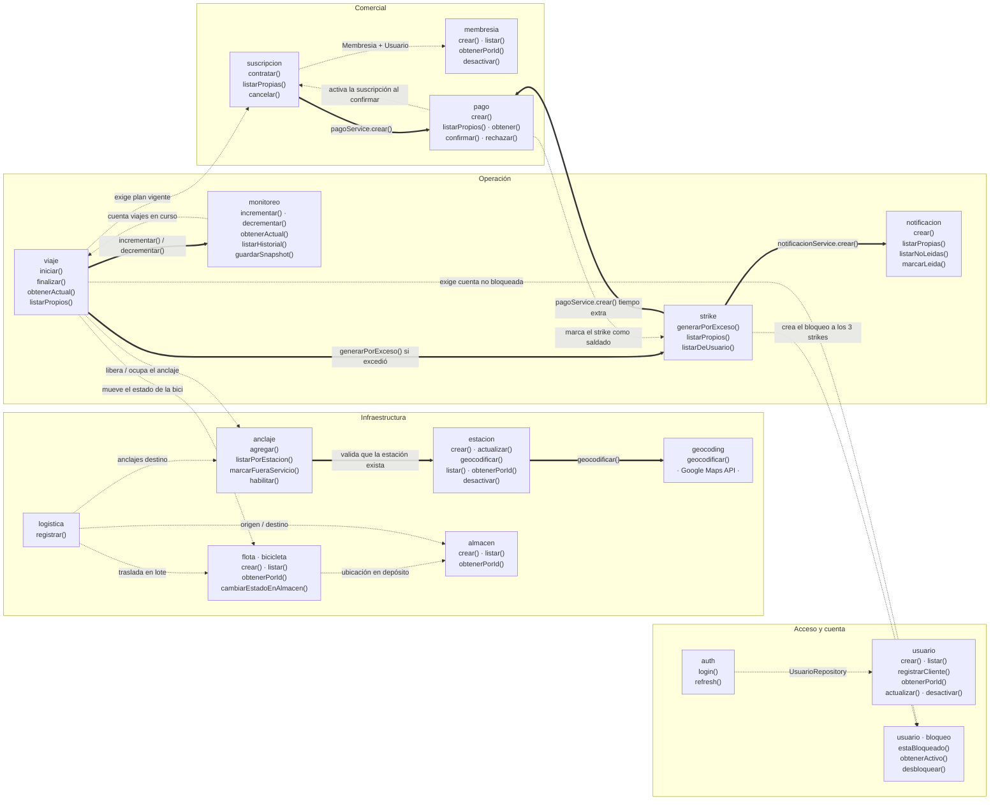
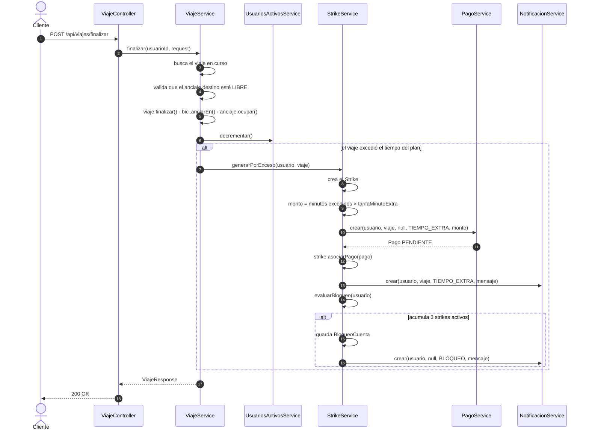
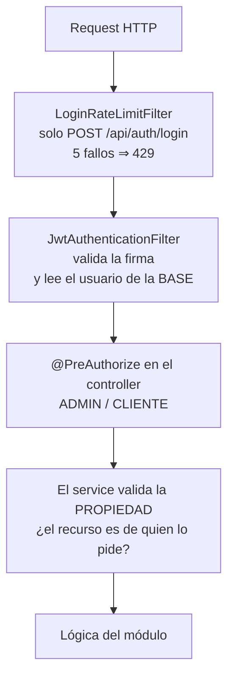

# PeopleBikes — Mapa de módulos, funciones e interacciones

Complementa a [DIAGRAMAS.md](DIAGRAMAS.md): allá está el modelo de dominio y los
flujos de negocio; acá está **qué función expone cada módulo y qué función de otro
módulo invoca**.

Todo lo que sigue está extraído del código, no del diseño previsto: las flechas son
imports y llamadas reales en `src/main/java/com/mediconecta/modulos/`.

Cada módulo repite las mismas cinco capas:

```
controller  →  recibe HTTP, valida el rol (@PreAuthorize), no tiene lógica
service     →  la lógica de negocio y las transacciones  ←── las flechas salen de acá
repository  →  Spring Data JPA
entity      →  la tabla y sus invariantes
dto         →  lo que entra y sale por HTTP (nunca se expone la entity)
```

---

## 1. Mapa general: módulos, sus funciones y quién llama a quién

Dos tipos de flecha, y la diferencia importa:

- **Línea llena** = un servicio llama a otro servicio. Acoplamiento fuerte y explícito.
- **Línea punteada** = un servicio lee el *repositorio* de otro módulo, sin pasar por
  su servicio. Acoplamiento por datos: más rápido de escribir, pero saltea las reglas
  que ese módulo pudiera tener.



> **No hay ciclos.** Ningún módulo depende de otro que dependa de él, ni directa ni
> transitivamente. Por eso el sistema se puede leer de arriba hacia abajo:
> `viaje` orquesta, `strike` reacciona, `pago` y `notificacion` son terminales.

---

## 2. Los tres orquestadores

De los 13 módulos, **10 son CRUD**: reciben un request, validan y persisten. Los que
concentran la lógica del negocio son tres, y son los que hay que mirar primero:

| Módulo | Función que orquesta | Qué coordina |
|---|---|---|
| `viaje` | `finalizar()` | anclaje + bicicleta + monitoreo + strike |
| `strike` | `generarPorExceso()` | pago + notificación + bloqueo de cuenta |
| `pago` | `confirmar()` | activa suscripción **o** salda strike, según el concepto |

`PagoService.confirmar()` es el punto donde el dinero mueve el estado del sistema: el
mismo método activa una suscripción si el pago era de un plan, o da por saldado un
strike si era de tiempo extra.

---

## 3. Secuencia real: devolver la bici fuera de tiempo

El camino de excepción completo, con los nombres de método tal como están en el
código. Es la interacción más densa del sistema — toca seis módulos.



El strike nace **activo**. Se salda cuando el cliente paga:
`PagoService.confirmar()` busca el strike asociado a ese pago y lo marca saldado. Si
llega a tres activos sin pagar, la cuenta queda bloqueada y solo un ADMIN la libera
con `BloqueoCuentaService.desbloquear()`.

---

## 4. Inventario completo de funciones

Las funciones públicas de cada servicio, que son la superficie real de cada módulo.

| Módulo | Servicio | Funciones |
|---|---|---|
| auth | `AuthService` | `login()` · `refresh()` |
| usuario | `UsuarioService` | `crear()` · `registrarCliente()` · `listar()` · `obtenerPorId()` · `actualizar()` · `desactivar()` |
| usuario | `BloqueoCuentaService` | `estaBloqueado()` · `obtenerActivo()` · `desbloquear()` |
| membresia | `MembresiaService` | `crear()` · `listar()` · `obtenerPorId()` · `desactivar()` |
| membresia | `SuscripcionUsuarioService` | `contratar()` · `listarPropias()` · `cancelar()` |
| pago | `PagoService` | `crear()` · `listarPropios()` · `obtener()` · `confirmar()` · `rechazar()` |
| estacion | `EstacionService` | `crear()` · `actualizar()` · `geocodificar()` · `listar()` · `obtenerPorId()` · `desactivar()` |
| estacion | `AnclajeService` | `agregar()` · `listarPorEstacion()` · `marcarFueraServicio()` · `habilitar()` |
| estacion | `GeocodingService` | `geocodificar()` — única salida a un servicio externo |
| flota | `BicicletaService` | `crear()` · `listar()` · `obtenerPorId()` · `cambiarEstadoEnAlmacen()` |
| almacen | `AlmacenService` | `crear()` · `listar()` · `obtenerPorId()` |
| logistica | `MovimientoBicisService` | `registrar()` — traslado en lote |
| viaje | `ViajeService` | `iniciar()` · `finalizar()` · `obtenerActual()` · `listarPropios()` |
| strike | `StrikeService` | `generarPorExceso()` · `listarPropios()` · `listarDeUsuario()` |
| notificacion | `NotificacionService` | `crear()` · `listarPropias()` · `listarNoLeidas()` · `marcarLeida()` |
| monitoreo | `UsuariosActivosService` | `inicializar()` · `incrementar()` · `decrementar()` · `obtenerActual()` · `listarHistorial()` · `guardarSnapshot()` |
| saludo | `SaludoService` | `saludar()` — componente de prueba, fuera del dominio |

---

## 5. Cómo se cruza la seguridad

La seguridad no es un módulo de dominio: es una capa que atraviesa a todos, en
`com.mediconecta.seguridad`.



Los cuatro controles son distintos y ninguno reemplaza a otro:

1. **Rate limit** — corta la fuerza bruta antes de tocar la base.
2. **Filtro JWT** — prueba *quién sos*. El rol y el estado salen de la base, no del
   token: degradar o dar de baja a alguien tiene efecto en el request siguiente.
3. **`@PreAuthorize`** — control por *rol*. Sirve para "esto es solo de ADMIN".
4. **Validación de propiedad en el service** — control por *dueño*. Es lo que impide
   que un cliente lea el pago de otro, y el rol no alcanza para eso: los dos son
   CLIENTE. Está en `PagoService`, `NotificacionService` y `SuscripcionUsuarioService`.
